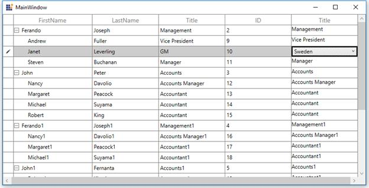

# How to Bind ViewModel ItemsSource to ComboBox inside Template in WPF / UWP TreeGrid in MVVM?

This example illustrates to bind the ComboBox ItemsSource that is loaded inside the template column in [WPF TreeGrid](https://www.syncfusion.com/wpf-controls/treegrid) and [UWP TreeGrid](https://www.syncfusion.com/uwp-ui-controls/treegrid) (SfTreeGrid).

You can load a ComboBox inside [TreeGridTemplateColumn](https://help.syncfusion.com/cr/wpf/Syncfusion.UI.Xaml.TreeGrid.TreeGridTemplateColumn.html) and bind the ItemsSource from ViewModel to ComboBox using ElementName binding.

```xml
<syncfusion:TreeGridTemplateColumn MappingName="Title" syncfusion:FocusManagerHelper.WantsKeyInput="True">
        <syncfusion:TreeGridTemplateColumn.CellTemplate>
            <DataTemplate>
                <TextBlock Text="{Binding Title}"/>
            </DataTemplate>
        </syncfusion:TreeGridTemplateColumn.CellTemplate>
        <syncfusion:TreeGridTemplateColumn.EditTemplate>
            <DataTemplate>
                <ComboBox ItemsSource="{Binding Path=DataContext.TitleList, ElementName=treeGrid}" />
            </DataTemplate>
        </syncfusion:TreeGridTemplateColumn.EditTemplate>
 </syncfusion:TreeGridTemplateColumn>
```

